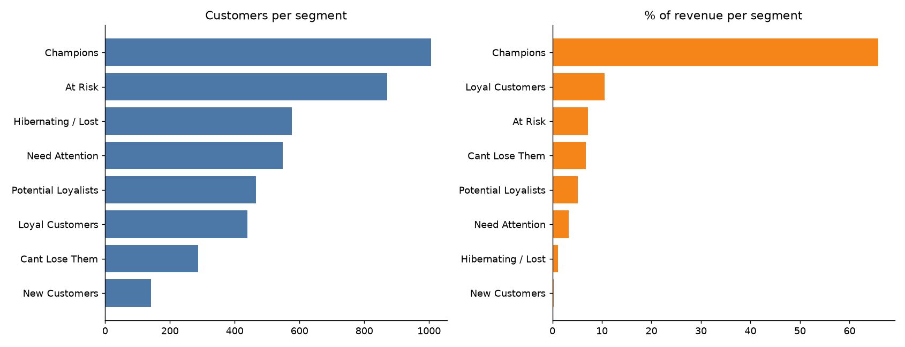
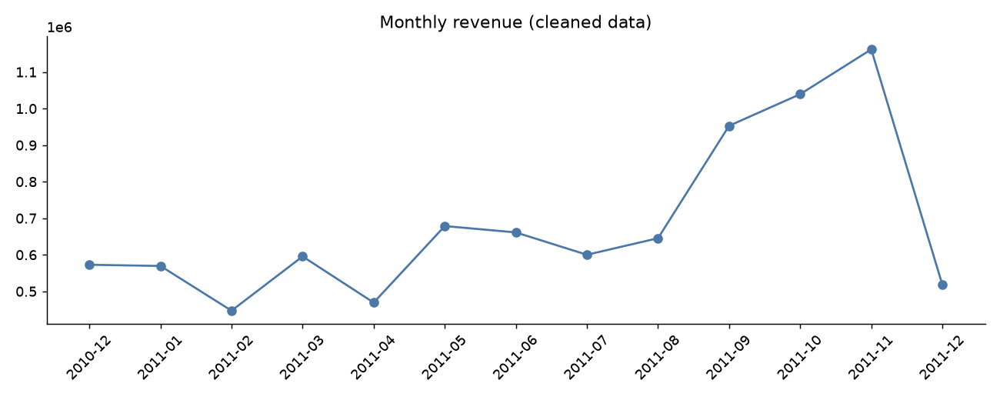

# Online Store Customer Segmentation (RFM in SQL)

Segment the customers of a UK online gift retailer with an RFM (Recency, Frequency, Monetary) model written in SQL.

**Data:** [UCI Online Retail](https://archive.ics.uci.edu/dataset/352/online+retail), 541,909 line items, Dec 2010 to Dec 2011.
**SQL skills shown:** `COUNT(DISTINCT)`, CTEs, window functions (`NTILE`), `CASE`, views, aggregation and joins. The SQL runs on SQLite.

## Project layout
```
sql/01_data_quality.sql      profile raw data, justify cleaning rules
sql/02_clean_view.sql        view clean_sales (real purchases by known customers)
sql/03_rfm_segmentation.sql  CTE-based RFM scoring + segment labels -> table rfm_segments
sql/04_segment_analysis.sql  business summaries (segments, countries, repeat buyers, monthly trend)
src/run_pipeline.py          loads Excel into SQLite, runs the SQL, exports CSVs and charts
outputs/                     CSV results and PNG charts
```

## Run it
```
pip install -r requirements.txt
# download the dataset (not stored in this repo): https://archive.ics.uci.edu/static/public/352/online+retail.zip
# unzip it so that data/raw/Online Retail.xlsx exists
python src/run_pipeline.py
```



The first run loads the Excel file into `data/retail.db` (about 1 minute). Later runs reuse it.

## Method
1. **Clean:** drop rows with no CustomerID (135,080), cancellations (invoice starts with `C`), and non-positive quantity or price. 73.4% of rows remain, covering 4,338 customers.
2. **Metrics per customer:** Recency = days from the snapshot date (day after the last transaction) to the last purchase. Frequency = `COUNT(DISTINCT InvoiceNo)`. Monetary = `SUM(Quantity * UnitPrice)`.
3. **Score:** `NTILE(5)` on each metric, where 5 is best. Frequency has many ties, so it is ranked by frequency and then monetary to get even quintiles.
4. **Label:** rule-based segments from R and F (and M for Champions). See `03_rfm_segmentation.sql`.

## Key findings
| Segment | Customers | % revenue | Avg orders | Avg recency (days) |
|---|---|---|---|---|
| Champions | 1,006 (23%) | **65.8%** | 10.7 | 13 |
| Loyal Customers | 440 | 10.5% | 5.4 | 41 |
| At Risk | 871 | 7.2% | 1.7 | 186 |
| Can't Lose Them | 288 | 6.8% | 4.8 | 131 |
| Potential Loyalists | 465 | 5.1% | 2.0 | 17 |
| Need Attention | 549 | 3.3% | 1.6 | 52 |
| Hibernating / Lost | 577 | 1.1% | 1.0 | 231 |
| New Customers | 142 | 0.3% | 1.0 | 19 |

- Revenue is concentrated: about a quarter of customers (Champions) bring about two thirds of revenue.
- Repeat buyers (2,845 customers) generate 93% of revenue. One-time buyers (1,493) generate 7%.
- The UK holds 3,920 of 4,338 customers and 83% of revenue. Overseas, the Netherlands, EIRE and Germany lead on revenue, and a handful of wholesale-sized buyers drive the Dutch and Irish totals.
- Revenue peaks in Sep to Nov 2011 (seasonal gift buying). December 2011 is a partial month.

## Recommended actions
- **Champions / Loyal:** rewards, early access and referrals. Protect them, since they carry the business.
- **Can't Lose Them / At Risk:** win-back campaigns with a personalised offer. They were valuable once, and this is the highest-ROI group.
- **Potential Loyalists / New:** onboarding and second-purchase incentives to raise frequency.
- **Hibernating:** low-cost email only. Revenue at stake is about 1%.

## Data credit
Chen, D. (2015). Online Retail [Dataset]. UCI Machine Learning Repository. Licensed CC BY 4.0.

## Limitations
- One year of data, so seasonality is confounded with recency.
- Quintile scoring is relative, so cutoffs shift with each dataset. Absolute thresholds would suit production use.
- Wholesale buyers and consumers are mixed together. Splitting them is a natural next step.
- Segment rules are heuristic and not validated against any outcome such as churn.
